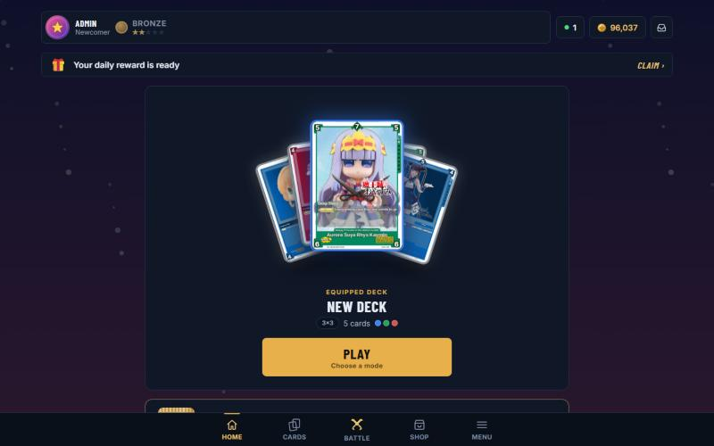
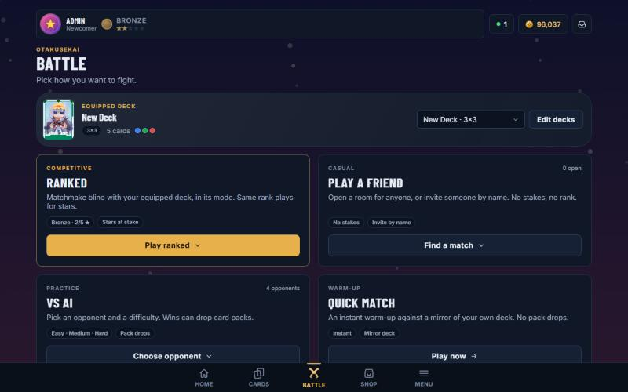
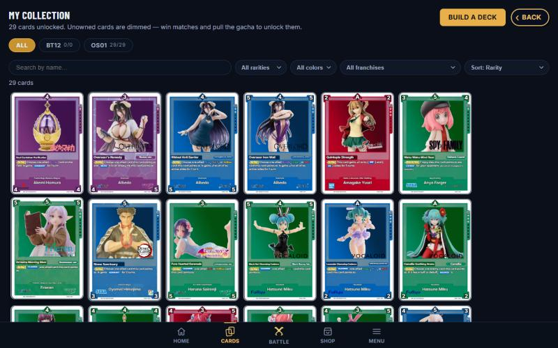

<div align="center">

# OtakuSekai

**A figure trading card game: collect cards, draft a hand and fight on a grid board.**

[Play in your browser](https://play.otakuswonderland.com) &nbsp;·&nbsp; [Download the app](https://play.otakuswonderland.com/download) &nbsp;·&nbsp; [Latest release](../../releases/latest)



</div>

> OtakuSekai is an unofficial, non-commercial fan project. Card art and the franchises it
> depicts belong to their owners.

---

## Contents

- [What is OtakuSekai?](#what-is-otakusekai)
- [Download and install](#download-and-install)
- [How a match works](#how-a-match-works)
- [Updates](#updates)
- [Troubleshooting](#troubleshooting)
- [About this repository](#about-this-repository)

## What is OtakuSekai?

OtakuSekai is a card game you play online against other players or against practice opponents.
Cards have numbers that point in different directions. Place a card next to an opponent's card,
and if your number beats theirs, you capture it.

- **Grid matches.** Two players place cards on a board from 3×3 up to 5×5. A match is best of
  three rounds.
- **Drafted hands.** Each match you pick a hand from your deck, under per-rarity limits (for
  example, at most one Legendary).
- **A collection that means something.** Cards come in rarities, tiers, foils and finishes.
- **Ranked, friends and practice.** A ranked queue with seasons, private rooms by name or QR
  code, and practice opponents at three difficulties.
- **Rewards.** Daily rewards, achievements, booster packs, a shop, a player marketplace and
  card trading.
- **Fair by design.** The server runs every match, so a modified app cannot cheat.

|                                    Battle                                    |                                    Collection                                    |
| :--------------------------------------------------------------------------: | :------------------------------------------------------------------------------: |
|  |  |

## Download and install

You do not have to install anything: the game runs in any modern browser at
**https://play.otakuswonderland.com**. The apps below are optional and just open the same game
in its own window.

Get them from **https://play.otakuswonderland.com/download**, or from the newest entry under
[Releases](../../releases) on this page.

| Platform    | File to download                                          |
| ----------- | --------------------------------------------------------- |
| **Windows** | `OtakuSekai.Setup.<version>.exe` (installer), or `OtakuSekai.<version>.exe` (portable, no install) |
| **Mac**     | `OtakuSekai-<version>-arm64.dmg`                          |
| **Linux**   | `OtakuSekai-<version>.AppImage`                           |
| **Android** | `.apk` from the newest `android-v…` release               |
| **iPhone / iPad** | No download: open the site in Safari, tap Share, then **Add to Home Screen** |

### Windows

1. Download `OtakuSekai.Setup.<version>.exe` and run it. If you prefer not to install, download
   the portable `OtakuSekai.<version>.exe` and run that instead.
2. Windows may show a blue **Windows protected your PC** box the first time, because the app is
   not signed with a paid certificate. Click **More info**, then **Run anyway**.

### Mac

1. Download the `.dmg`, open it and drag OtakuSekai to **Applications**.
2. The first time, right-click the app and choose **Open**, then confirm. macOS asks only once.

### Linux

```bash
chmod +x OtakuSekai-*.AppImage
./OtakuSekai-*.AppImage
```

### Android

1. Download the `.apk` from the newest `android-v…` release on your phone.
2. Open it. Android asks you to allow installs from your browser or file manager: allow it for
   this install.
3. Open **OtakuSekai** from your app drawer. Notifications work like on the website.

### Any phone, tablet or computer

Open https://play.otakuswonderland.com and use your browser's **Install app** or **Add to Home
Screen** option. This gives you the same app icon without downloading a file.

## How a match works

1. **Pick a mode:** ranked, a friend, a practice opponent or a quick match.
2. **Draft your hand** from your deck.
3. **Take turns placing a card** on an empty tile. Each card's numbers point at its neighbours.
   If yours beats the number facing it, that card becomes yours.
4. Some cards have **abilities** that trigger when placed or captured.
5. The player holding the most cards when the board fills up wins the round. **Best of three
   rounds** wins the match.

New players get a short in-game **Learn to Play** walkthrough.

## Updates

The app is a small launcher that opens the live game, so **the game updates itself**. New
cards, features and fixes reach you the moment they are released, with nothing to download.

A new app file is only published if the launcher itself changes, which is rare. If your copy
ever becomes too old, the app shows an **update needed** screen with a download button.

## Troubleshooting

| Problem | What to try |
| ------- | ----------- |
| Windows says it protected your PC | Click **More info**, then **Run anyway**. |
| Mac says the app cannot be opened | Right-click the app, choose **Open**, then confirm. |
| Linux file does not start | Run `chmod +x` on the `.AppImage` first. |
| The app shows an offline screen | Check your internet connection. The game needs to be online. |
| Android refuses to install the file | Allow installs from your browser or file manager in Android settings. |
| Something looks wrong after an update | Close and reopen the app; refresh the page in a browser. |

Still stuck? Open an [issue](../../issues) and say your platform and what you saw.

## About this repository

This repository holds the **source of the desktop and Android launchers** and the recipe that
builds them. It contains no game code, card data or secrets. The game itself runs on the
OtakuSekai servers.

```text
src/                      the desktop launcher (a few small files)
resources/                the app icon
android/                  the Android app: a thin shell around the live game
scripts/                  build helper for the Mac app
.github/workflows/        builds Windows, Mac and Linux, and the Android APK, and publishes releases
```

- **Desktop** builds run when the launcher source or the `version` in `package.json` changes.
  They publish a release named `v<version>`.
- **Android** builds publish a release named `android-v<version>`.
- The download page on the website reads the newest release from here, so keep file names
  stable.
